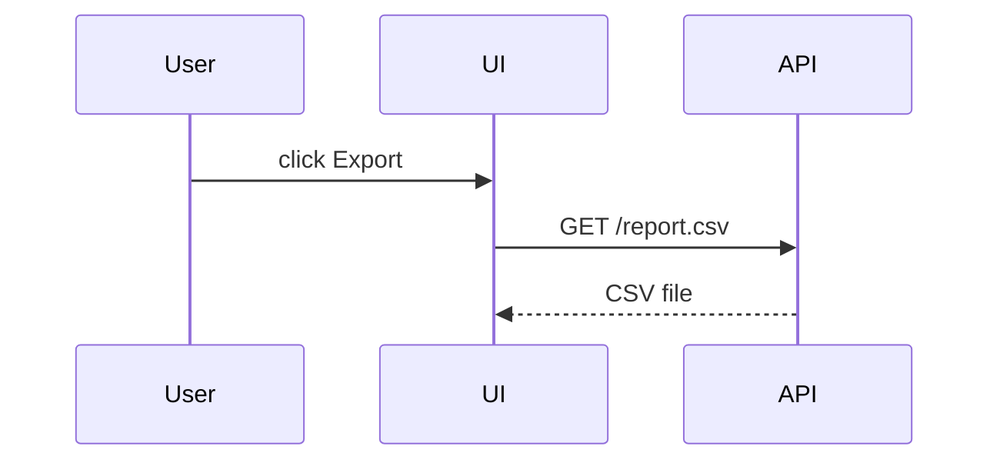

# Visuals in Markdown files

The `.md` files of `flow` and `task` are read by the user. Where a shape, a flow or a change is the point, show it instead of describing it. Pick the smallest view that makes the point, place it next to the short text it supports, and keep only the calls, files, states and boundaries that matter for it. Most sections need one visual or none; prose stays brief around it.

## Forms

Logic or an algorithm: pseudocode.

```text
on(export)
  if rows are empty
    show "Nothing to export"
  write header, then one line per row
```

Runtime control flow: a call tree.

```text
exportReport
  loadFilteredRows
  toCsv
    quoteValue
  download
```

UI structure: a component tree, with the state and module boundaries that matter.

```tsx
<ReportPage> (src/routes/report.tsx)
  useReportFilters()
  <ReportToolbar>
    <ExportButton> (packages/ui)
```

File responsibility: a shallow file tree.

```text
src/
├── export/     # builds the CSV
└── report/     # owns the filters
```

Interaction or data flow between parts: Mermaid (`sequenceDiagram`, `flowchart`, `stateDiagram-v2`).



What changes, when the surrounding shape already exists: `diff` in the shape of the topic (component tree, file tree, call tree, pseudocode).

```diff
 exportReport
   loadFilteredRows
+  toCsv
+    quoteValue
   download
```

Show the whole block instead of a diff when most of it is new, or when omitted context would hide ownership or order.

## Where they fit

| Section | Usual visual |
|---|---|
| `task` context (`NOW-n`): how the code works today | call tree, file tree, component tree, Mermaid of the current flow |
| `task` `brief.md` BRIEF-1 Today | the one picture of today from context (cite its id, don't redraw it in full) |
| `task` `brief.md` BRIEF-2 Target | `diff` over today's shape |
| `task` `brief.md` BRIEF-3 Path | Mermaid `flowchart` of the order of the work, or a numbered list when it is linear |
| `flow` `spec.md` Notes (M design) | `diff` of the file tree or call tree |
| `flow` `design.md` (L) | component tree or Mermaid of the flow, `diff` of the data shape, the rejected option side by side when it helps |

## Rules

- Real names only: files, functions, components and states as they are in the code.
- One fact lives in one place: a visual that restates a context section cites its id instead.
- No HTML in these files. A page for outside readers is `task consolidate --publish`'s job.
- Plain prose wins when the point is one sentence.
